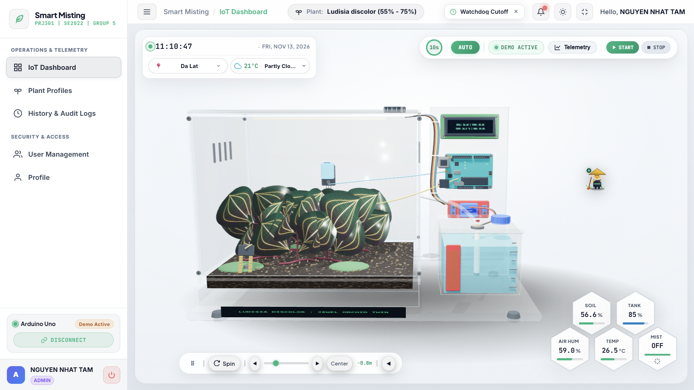
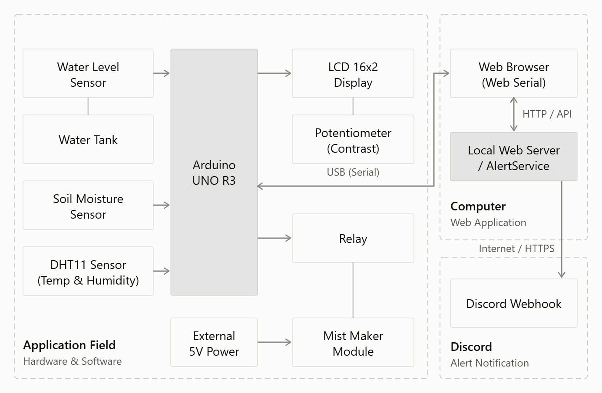
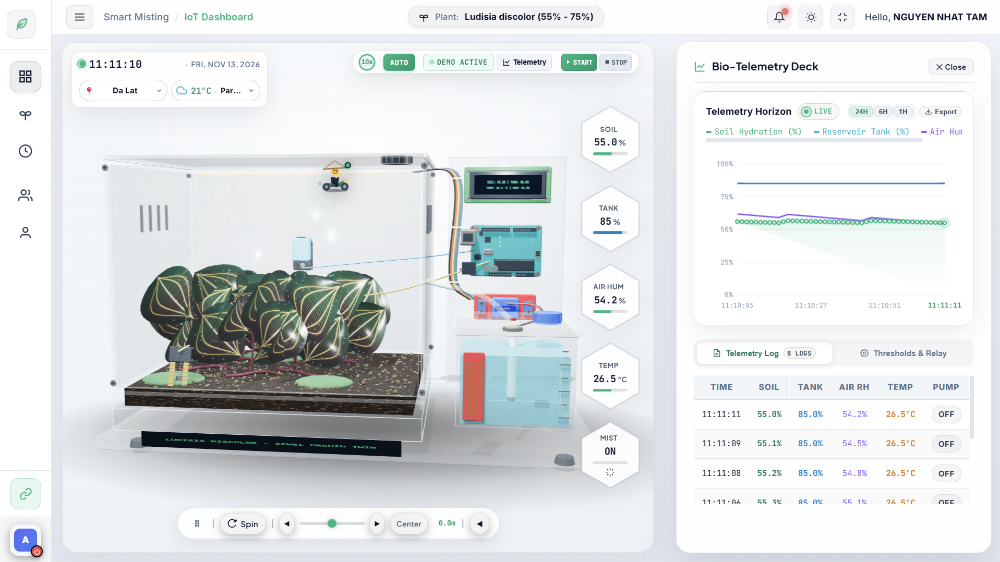
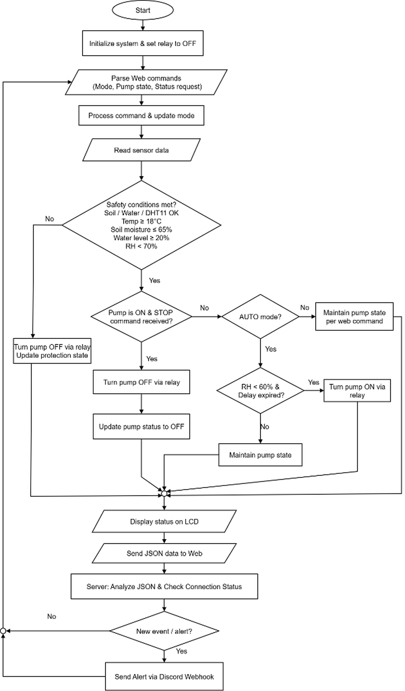
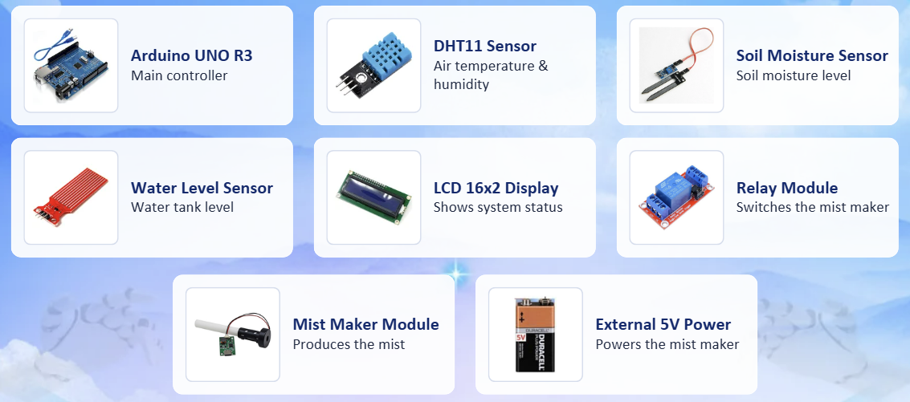
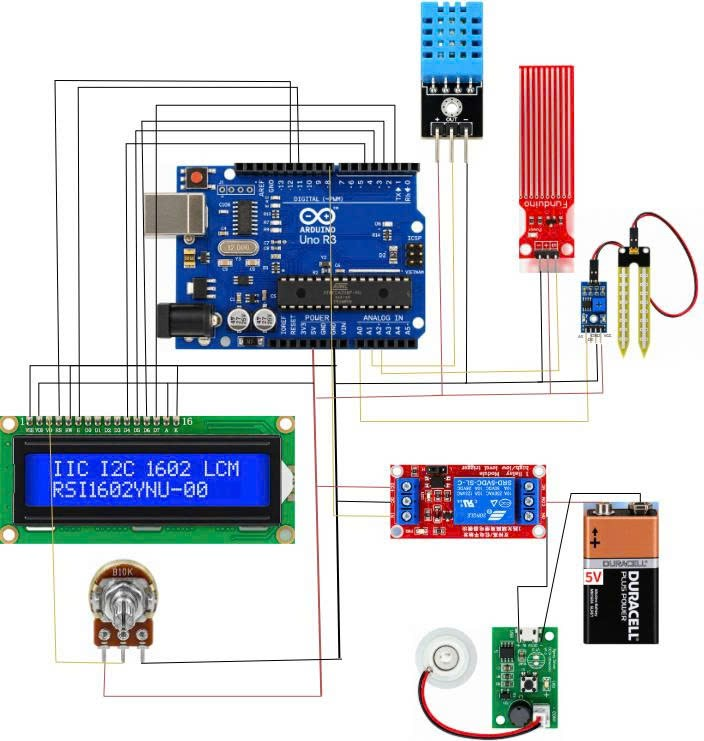

<div align="center">

# Smart Automatic Misting Irrigation System with Web Monitoring

### A Telemetry-Verified SCADA Architecture with Autonomous Firmware Safety Interlocks

[](https://www.oracle.com/java/)
[](https://tomcat.apache.org/)
[](https://tomcat.apache.org/)
[](https://www.microsoft.com/sql-server/)
[](https://www.arduino.cc/)
[](https://wicg.github.io/serial/)
[](tests/)
[](SmartMisting_Report.pdf)

<br/>

**[Technical Paper (PDF)](SmartMisting_Report.pdf)** • **[Video Demonstration](VIDEO_DEMO.mp4)** • **[System Architecture](#-system-architecture)** • **[Empirical Results](#-empirical-evaluation-benchmarks-table-ii)** • **[Replication Guide](#-quickstart--replication-guide)**

<br/>



*Figure 1: SmartMisting Web SCADA Dashboard with an interactive 3D digital twin, real-time sensor telemetry, automated/manual misting controls, and administrative management panel.*

</div>

---

## 📌 Executive Summary

Compact terrariums and microclimate enclosures require reliable air-humidity regulation without over-saturating substrate root zones. Traditional IoT irrigation architectures often rely on external native gateways or cloud-tethered relays, introducing actuation latency and risking catastrophic over-watering or transducer burnout during network disconnections.

**SmartMisting** introduces a browser-native Supervisory Control and Data Acquisition (SCADA) system integrating an Arduino Uno R3 edge controller with an enterprise Java Servlet/JSP and Microsoft SQL Server backend through direct USB serial communication:
- **Zero Native Middleware**: The browser directly communicates with the physical microcontroller via the **W3C Web Serial API** at 9600 baud, eliminating third-party background daemon processes.
- **Exclusive Multi-Tab Concurrency**: The **W3C Web Locks API** enforces single-tab USB port ownership across multiple browser tabs on the same origin, preventing serial port collision while allowing concurrent supervisory client sessions.
- **Telemetry-Verified Physical Acknowledgment**: A web command is never treated as executed upon serial transmission; actuation is acknowledged only after subsequent Arduino JSON telemetry frames confirm the actual relay state.
- **Autonomous Firmware-First Safety Interlocks**: The microcontroller independently executes safety checks and emergency cutoffs (water reservoir $<20\%$, soil moisture $>65\%$, ambient temperature $<18.0^\circ\text{C}$ or $>38.0^\circ\text{C}$, and analog open-circuit rail detection $\le 15$ or $\ge 1018$) in $\le 500\text{ ms}$, ensuring complete fail-safe isolation even if the host computer or browser disconnects.

---

## 🏗️ System Architecture

<div align="center">

</div>

The system comprises four decoupled functional layers:
1. **Physical Sensing & Actuation Layer**: Arduino Uno R3 sampling calibrated analog soil probes (A0), reservoir resistive liquid sensors (A2), and DHT11 digital environmental probes (A1). Actuation is driven by an active-LOW 5V relay module (D8) connected to an ultrasonic misting transducer.
2. **Host Browser Serial Bridge Layer**: A Chromium-based supervisory client using `navigator.serial` at 9600 baud (8N1) and `navigator.locks` to maintain telemetry streaming at 1 Hz and relay serialized command packets.
3. **Enterprise Web Application & Persistence Layer**: A Java Servlet/JSP container (Apache Tomcat 9) backed by Microsoft SQL Server via pure JDBC (`PreparedStatement`). Enforces four-tier Role-Based Access Control (RBAC: Admin, Staff, Expert, Guest) and hashes passwords using PBKDF2WithHmacSHA256 (120,000 iterations).
4. **Outbound Incident Notification & Watchdog Layer**: Outbound webhooks dispatch formatted Industrial IoT embeds to Discord with 3-consecutive-sample filtering and a 15-message/minute rate limiter, while external heartbeats monitor host uptime via Healthchecks.io.

<div align="center">

<br/>
<em>Figure 3: Browser-Hosted Bio-Telemetry Deck displaying live spline charting and persistent execution audit logs.</em>
</div>

---

## ⚙️ Control Flow & Hysteresis Logic

<div align="center">

</div>

### Closed-Loop Automation (AUTO Mode)
- **Activation Condition**: Relative Humidity ($\text{Air RH}$) falls below **$60.0\%$**. Pump turns `ON` continuously.
- **Hysteresis Hold**: Between **$60.0\%$ and $69.9\%$**, the current pump state is preserved, preventing relay chatter around the trigger boundary.
- **Deactivation Condition**: Relative Humidity reaches or exceeds **$70.0\%$**. Pump turns `OFF` immediately.
- **Relay Dwell Guard**: A 2.5-second debounce cooldown prevents rapid electrical relay switching.

### Hardware Safety Overrides (Always Active)
| Safety Interlock | Monitored Parameter | Trip Threshold | Action Taken | Recovery Behavior |
|---|---|---|---|---|
| **Dry-Run Burnout Protection** | Water Reservoir | $\text{Level} < 20\%$ | Immediate pump cutoff ($\le 500\text{ ms}$) | Manual refill required ($\ge 20\%$) |
| **Root Rot & Hypoxia Guard** | Soil Substrate Moisture | $\text{Moisture} > 65\%$ | Immediate pump cutoff ($\le 500\text{ ms}$) | Misting inhibited until natural drainage |
| **Cold-Water Shock Guard** | Ambient Chamber Temp | $\text{Temp} < 18.0^\circ\text{C}$ | Immediate pump cutoff ($\le 500\text{ ms}$) | Autonomous resumption at $\ge 18.0^\circ\text{C}$ |
| **Scald Prevention Guard** | Ambient Chamber Temp | $\text{Temp} > 38.0^\circ\text{C}$ | Immediate pump cutoff ($\le 500\text{ ms}$) | Autonomous resumption at $\le 38.0^\circ\text{C}$ |
| **Sensor Disconnect Watchdog** | Analog & Digital Lines | Open circuit / Stale $>7\text{ s}$ | Hard interlock shutdown | Reconnect probe; clear error |

---

## 📊 Empirical Evaluation Benchmarks (Table II)

The prototype was rigorously evaluated on Windows 11 with Apache Tomcat 9.0, Microsoft SQL Server, and an Arduino Uno R3 under physical environmental conditions.

| Metric / Evaluation Criterion | Empirical Benchmark | Engineering Significance |
|---|:---:|---|
| **Serial Telemetry Rate** | **1 Hz (9600 baud, 8N1)** | Non-blocking JSON streaming with zero frame collision |
| **Relative Humidity Response ($55\% \rightarrow 70\%$)** | **42.6 s** | Single trial rise time in sealed $0.027\text{ m}^3$ acrylic terrarium |
| **Hardware Safety Trip Latency** | **$< 500\text{ ms}$** | Pump shuts down within a single control loop iteration |
| **Analog ADC Sampling Time** | **2.26 ms (20 samples)** | Oversampling filter eliminating electrical relay EMF transients |
| **Relay Debounce Dwell** | **2.5 s** | Prevents mechanical relay fatigue and contact arcing |
| **Command Acknowledgment Timeout** | **4.0 s** | Automatic UI rollback if physical controller does not confirm |
| **Java Security & Policy Test Suite** | **19 / 19 Passed (100%)** | Validates RBAC matrix, JSON serialization, and PBKDF2 hashing |
| **JavaScript Integration Test Suite** | **11 / 11 Passed (100%)** | Validates WebSerial FIFO queue, hysteresis, and viewer locks |
| **Firmware Protocol & Safety Test Suite** | **20 / 20 Passed (100%)** | Validates cutoff interlocks, timed pulses, and buffer overflow |
| **Total Automated Assertions** | **50 / 50 Passed (100%)** | Full end-to-end regression coverage across all 3 layers |
| **Acceptance Scenarios** | **5 / 5 Passed (100%)** | Closed-loop control, sensor fault, timed pulse, RBAC, persistence |
| **Discord Alert Throttle Cap** | **15 msgs / minute** | Token-bucket rate limiter preventing webhook HTTP 429 bans |
| **External Watchdog Monitoring** | **243 pings (13h 31m outage tracked)** | Independent availability tracking without internal server bias |

---

## 🔌 Hardware Instrumentation & Pinout Mapping

<div align="center">

<br/>

</div>

| Pin Identifier | Component | Interface Type | Electrical Calibration & Thresholds |
|:---:|:---:|:---:|---|
| **A0** | Capacitive/Resistive Soil Probe | Analog Input | Dry Air: $\text{ADC} \approx 980$ ($0\%$) • Submerged: $\text{ADC} \approx 300$ ($100\%$) |
| **A1** | DHT11 Environmental Probe | Digital I/O | Temperature: $-10^\circ\text{C}\text{ to }80^\circ\text{C}$ • Humidity: $0\%\text{ to }100\%\text{ RH}$ |
| **A2** | Water Reservoir Sensor | Analog Input | Dry Tank: $\text{ADC} \le 80$ ($0\%$) • Full Tank: $\text{ADC} \approx 500$ ($100\%$) |
| **D8** | 5V Relay Actuator Module | Digital Output | Active LOW polarity (`LOW = Pump ON`, `HIGH = Pump OFF`) |
| **D12, D11, D5, D4, D3, D2** | 1602 HD44780 LCD Display | 4-Bit Parallel | Alternates Page 0 (Soil/Water status) & Page 1 (DHT11 climate) every 2 s |
| **USB Type-B** | FTDI / ATmega16U2 | Serial Bus | 9600 Baud, 8 Data Bits, No Parity, 1 Stop Bit (8N1) |

---

## 🧪 Automated Test Verification

The repository includes a comprehensive 50-assertion test suite that can be reproduced locally:

```bash
# 1. Java Security, RBAC & Serialization Tests (19 assertions)
javac -cp "build/web/WEB-INF/classes" tests/PolicyTest.java
java -cp "build/web/WEB-INF/classes;tests" PolicyTest
# Output: PASS 19 Java policy, password and JSON assertions

# 2. JavaScript SCADA WebSerial & Closed-Loop Simulation Tests (11 assertions)
node tests/integration.test.js
# Output: PASS 11 JavaScript integration assertions

# 3. Microcontroller Protocol & Safety Interlock Tests (20 assertions)
g++ -std=c++11 -I tests/firmware/stubs tests/firmware/firmware_test.cpp -o tests/firmware/firmware_test
./tests/firmware/firmware_test
# Output: PASS 20 firmware host assertions using actual .ino source (not AVR/board test)
```

---

## 🚀 Quickstart & Replication Guide

### Prerequisites
- **JDK**: Java Development Kit 8 (1.8.0) or higher.
- **Servlet Container**: Apache Tomcat 9.0.x (or 10.x with Jakarta compatibility).
- **Build Tool**: Apache Ant 1.10+.
- **Database**: Microsoft SQL Server 2017 / 2019 / 2022 / Express.
- **Hardware Host**: Chromium-based browser (Chrome, Edge, Brave, Opera) supporting the Web Serial API.

### Step 1: Database Initialization
1. Open **SQL Server Management Studio (SSMS)** or `sqlcmd`.
2. Execute [database/FULL_DATABASE_SETUP.sql](database/FULL_DATABASE_SETUP.sql) to initialize `MistingDB`, database constraints, default RBAC roles, and seed plant catalogs:
   ```cmd
   sqlcmd -S localhost -U sa -P your_password -i database/FULL_DATABASE_SETUP.sql
   ```

### Step 2: Environment Configuration
1. Duplicate the template configuration file:
   ```cmd
   copy prj_sm_config.example.properties prj_sm_config.properties
   ```
2. Configure your local database credentials and optional Discord webhook:
   ```properties
   db.url=jdbc:sqlserver://127.0.0.1:1433;databaseName=MistingDB;encrypt=false;trustServerCertificate=true;loginTimeout=3;socketTimeout=5000
   db.user=sa
   db.password=your_db_password
   discord.webhook.url=https://discord.com/api/webhooks/YOUR_WEBHOOK_ID/YOUR_WEBHOOK_TOKEN
   hc.ping.url=https://hc-ping.com/YOUR-UUID
   ```

### Step 3: Flash Arduino Firmware
1. Open [arduino/SmartMisting_PRJ301/SmartMisting_PRJ301.ino](arduino/SmartMisting_PRJ301/SmartMisting_PRJ301.ino) in the Arduino IDE.
2. Select Board: **Arduino Uno**, Port: your connected COM port.
3. Click **Upload** (9600 baud).

### Step 4: Build and Deploy the Web Application
1. Compile and package the WAR archive using Apache Ant:
   ```cmd
   ant clean dist
   ```
2. Deploy the generated archive `dist/SmartMistingPRJ.war` to Apache Tomcat's `webapps/` folder.
3. Access the SCADA console at:
   ```
   http://localhost:8080/SmartMistingPRJ/
   ```
4. Authenticate using default seeded credentials:
   - **Administrator**: `admin01` / `Admin@123`
   - **Operator (Staff)**: `staff01` / `Staff@123`
5. Connect your Arduino via USB and click **Connect Hardware** to start the telemetry stream.

---

## 📂 Repository Organization

```
PRJ301_SmartMisting/
├── SmartMisting_Report.pdf                     # Technical Paper (Full Manuscript PDF)
├── VIDEO_DEMO.mp4                              # Prototype Demonstration Video
├── docs/                                       # High-resolution system diagrams & UI captures
│   └── img/
│       ├── dashboard-ui.png                    # 3D Digital Twin & Web SCADA Dashboard UI
│       ├── telemetry-deck.png                  # Bio-Telemetry Deck live charts & log analytics
│       ├── hardware-components.png             # Instrumented sensor and actuator components
│       ├── architecture.jpg                    # Four-tier system architecture
│       ├── flowchart.png                       # Control flow and hysteresis decision tree
│       └── wiring.png                          # Arduino Uno pinout and electrical wiring
├── arduino/
│   └── SmartMisting_PRJ301/
│       └── SmartMisting_PRJ301.ino             # Production Arduino firmware
├── database/
│   ├── 01_schema.sql                           # Database tables & constraints
│   ├── 02_sample_data.sql                      # Seed data & plant specifications
│   ├── 03_verification.sql                     # Verification & sanity checks
│   └── FULL_DATABASE_SETUP.sql                 # Complete one-click database setup
├── hardware/
│   └── Original_Wiring.drawio                  # Pinout wiring schematics
├── tests/
│   ├── PolicyTest.java                         # Java policy, RBAC & JSON unit tests (19 assertions)
│   ├── integration.test.js                     # SCADA WebSerial & logic integration tests (11 assertions)
│   └── firmware/
│       ├── firmware_test.cpp                   # Firmware safety & protocol test harness (20 assertions)
│       └── stubs/                              # Arduino hardware mock headers
├── src/java/
│   ├── controller/                             # Servlets (Dashboard, Sensor, Control, History, etc.)
│   ├── dao/                                    # Pure JDBC Data Access Objects
│   ├── filter/                                 # Security, CSRF & RBAC AuthFilter
│   ├── listener/                               # Application lifecycle listeners
│   ├── model/                                  # POJO entity models
│   ├── service/                                # SCADA core, AlertManager, DiscordNotifier
│   └── util/                                   # DBContext, PasswordUtil (PBKDF2), Json
├── web/
│   ├── WEB-INF/
│   │   ├── views/                              # Protected JSP views (MVC architecture)
│   │   └── web.xml                             # Servlet mappings & session timeouts
│   ├── css/                                    # Responsive styling & 3D theme
│   └── js/                                     # main.js, prj-integration.js, garden3d.js
├── prj_sm_config.example.properties            # Configuration template
├── build.xml                                   # Apache Ant build script
└── README.md
```

---

## 📄 Reference & Documentation
- **Technical Paper (Full Manuscript)**: [SmartMisting_Report.pdf](SmartMisting_Report.pdf)
- **Live Video Demonstration**: [VIDEO_DEMO.mp4](VIDEO_DEMO.mp4)
- **Primary References**:
  - W3C, *"Web Locks API: W3C Candidate Recommendation Snapshot"*, 2024. [https://www.w3.org/TR/web-locks/](https://www.w3.org/TR/web-locks/)
  - WICG, *"Web Serial API: Draft Community Group Report"*, 2024. [https://wicg.github.io/serial/](https://wicg.github.io/serial/)
  - K. Moriarty et al., *"PKCS #5: Password-Based Cryptography Specification Version 2.1"*, RFC 8018, 2017.
  - OWASP Foundation, *"Password Storage Cheat Sheet"*, 2024.
