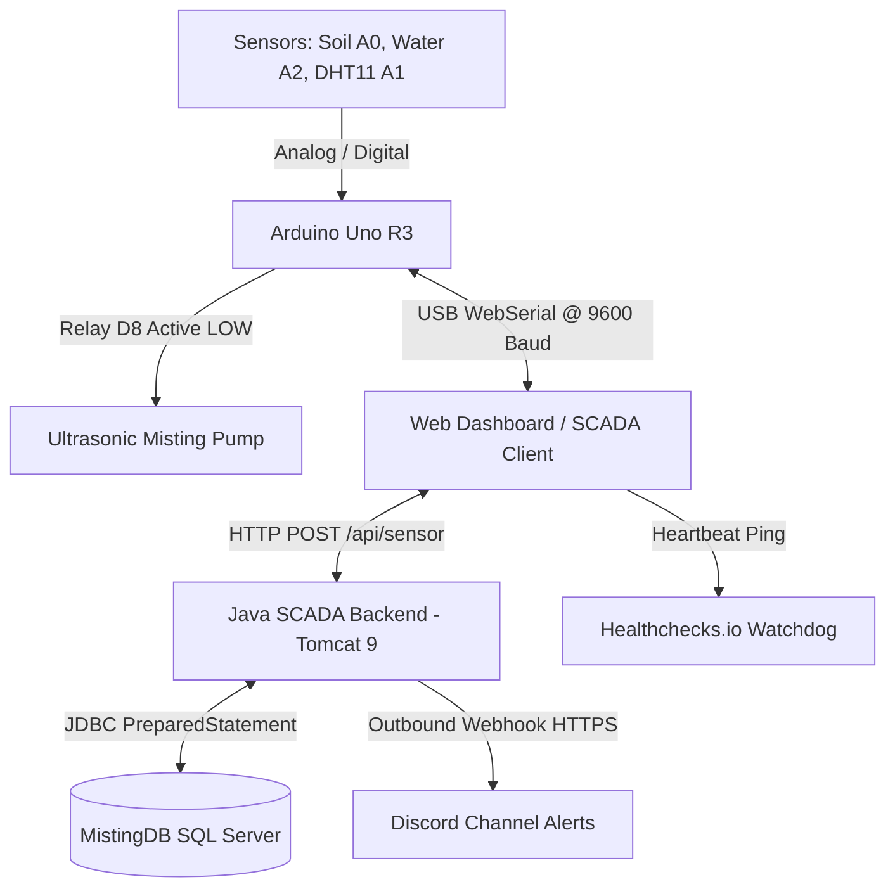

# Smart Automatic Misting Irrigation System with Web Monitoring

> **Paper Title**: Smart Automatic Misting Irrigation System with Web Monitoring  
> **Authors**: Nguyen Nhat Tam, Vu Huy Hoang, Nguyen Quoc Thinh, Thu Le (FPT University, Ho Chi Minh Campus)  
> **Course**: PRJ301 - Java Web Application Development & IoT Automation  
> **Specimen Target**: *Ludisia discolor* (Jewel Orchid / Lan Gấm)  
> **Platform**: Java Servlet & JSP (JDK 1.8), Apache Tomcat 9/10, Microsoft SQL Server, Arduino Uno R3, WebSerial API, Three.js 3D Digital Twin.

---

## 📌 Project Overview

The Smart Misting System is an enterprise-grade IoT SCADA application designed to automate, monitor, and regulate precision microclimates for sensitive botanical specimens (*Ludisia discolor*). The system combines real-time hardware telemetry via WebSerial, closed-loop hysteresis automation ($60\% - 70\%$ relative humidity), interactive 3D digital twin visualization, and outbound operational notifications via Discord webhooks and Healthchecks watchdog monitoring.

---

## 🏗️ System Architecture



---

## 🌟 Key Features

1. **3D Digital Twin Terrarium**:
   - Interactive 3D visualization using Three.js displaying the physical terrarium chamber, specimen canopy, fluid levels, and real-time mist particle dispersion.
   - Real-time sensor spotlight callouts highlighting individual sensor nodes upon inspection.

2. **Real-time Honeycomb Telemetry**:
   - **SOIL**: Substrate moisture percentage ($0 - 100\%$).
   - **TANK**: Water reservoir capacity ($0 - 100\%$).
   - **AIR HUM**: Relative humidity from calibrated DHT11 probe ($0.0 - 100.0\%$).
   - **TEMP**: Ambient chamber temperature in $^{\circ}\text{C}$.
   - **MIST**: Live relay actuation state (`ACTIVE` / `IDLE`).

3. **Agronomic Priority Safety Lockouts**:
   - **Low Water Cutoff ($< 20\%$)**: Disables pump immediately to prevent dry-running and transducer burnout.
   - **Cold Temperature Cutoff ($< 18.0^{\circ}\text{C}$)**: Inhibits misting to avoid cold-water shock on *Ludisia discolor* leaf and root tissues.
   - **High Temperature Cutoff ($> 38.0^{\circ}\text{C}$)**: Prevents scalding mist formation under extreme ambient heat.
   - **Substrate Saturation Cutoff ($> 65\%$)**: Halts irrigation to prevent root hypoxia and bacterial soft rot (*Pythium* rot).
   - **Sensor Diagnostic Guard**: Automatically locks actuation if DHT11 or analog probes become stale or disconnected.

4. **Operating Modes**:
   - **AUTO (Closed-Loop SCADA)**: Continuously mists when $\text{Air RH} < 60\%$, maintains state in buffer ($60\% - 69.9\%$), and stops when $\text{Air RH} \ge 70\%$.
   - **MANUAL**: Operator-triggered actuation via UI or timed pulse (`RUN:<seconds>`), strictly guarded by hardware safety interlocks.

5. **Discord & Heartbeat SCADA Integration**:
   - Outbound Industrial IoT embeds for system status updates, mode transitions, interlocks, and recoveries.
   - Periodic heartbeat pings to Healthchecks.io watchdog monitoring.

---

## 📊 Measured and Reported Prototype Results (Table II)

| Metric or Test | Measured Result |
|---|---|
| **Serial Telemetry Rate** | 1 Hz; 9600 baud (8N1 JSON stream) |
| **Relative Humidity Response (55% to 70%)** | 42.6 s (single trial) |
| **Reservoir / Soil / Sensor Cutoff Delay** | < 500 ms (within single control cycle) |
| **Analog ADC Sampling Time** | 20 samples; 2.26 ms |
| **Relay Dwell / Command Timeout** | 2.5 s debounce / 4.0 s confirmation timeout |
| **Java / JS / Firmware Test Assertions** | **19 / 11 / 20 passed (50 / 50 total)** |
| **End-to-End Acceptance Scenarios** | **5 / 5 passed** |
| **Ordinary Alert Rate Cap** | 15 messages per minute |
| **External Watchdog Monitoring** | 243 pings; 13 h 31 min outage tracked |

---

## 🧪 Automated Test Suites (50 / 50 Passing)

The project includes 50 comprehensive automated assertions across all three architectural layers:

```bash
# 1. Java Policy, Model & Password Security Suite (19 assertions)
javac -cp "build/web/WEB-INF/classes" tests/PolicyTest.java
java -cp "build/web/WEB-INF/classes;tests" PolicyTest
# Output: PASS 19 Java policy, password and JSON assertions

# 2. JavaScript SCADA WebSerial & Integration Suite (11 assertions)
node tests/integration.test.js
# Output: PASS 11 JavaScript integration assertions

# 3. Firmware Protocol & Safety Interlock Suite (20 assertions)
g++ -I tests/firmware/stubs tests/firmware/firmware_test.cpp -o tests/firmware/firmware_test
./tests/firmware/firmware_test
# Output: PASS 20 firmware host assertions using actual .ino source (not AVR/board test)
```

---

## 📂 Project Structure

```
PRJ301_SmartMisting/
├── SmartMisting.pdf                            # Technical Paper (IEEE Format)
├── VIDEO_DEMO.mp4                              # Prototype Demonstration Video
├── arduino/
│   └── SmartMisting_PRJ301/
│       └── SmartMisting_PRJ301.ino             # Production Arduino firmware
├── database/
│   ├── 01_schema.sql                           # Database tables & constraints
│   ├── 02_sample_data.sql                      # Seed data & plant specifications
│   ├── 03_verification.sql                     # Verification & sanity checks
│   └── FULL_DATABASE_SETUP.sql                 # Complete one-click database setup
├── hardware/
│   └── Original_Wiring.drawio                  # Pinout wiring schematics
├── report/
│   ├── SmartMisting_Report.pdf                 # Full technical report PDF
│   ├── PRJ301_Smart_Misting_Report.pdf         # Technical report copy
│   └── PRJ301_Smart_Misting_Report.docx        # Technical report Word document
├── tests/
│   ├── PolicyTest.java                         # Java policy, RBAC & JSON unit tests (19 assertions)
│   ├── integration.test.js                     # SCADA WebSerial & logic integration tests (11 assertions)
│   └── firmware/
│       ├── firmware_test.cpp                   # Firmware safety & protocol test harness (20 assertions)
│       └── stubs/                              # Arduino hardware mock headers
├── src/java/
│   ├── controller/                             # Servlets (Dashboard, Sensor, Control, History, etc.)
│   ├── dao/                                    # Pure JDBC Data Access Objects
│   ├── filter/                                 # Security, CSRF & RBAC AuthFilter
│   ├── listener/                               # Application lifecycle listeners
│   ├── model/                                  # POJO entity models
│   ├── service/                                # SCADA core, AlertManager, DiscordNotifier
│   └── util/                                   # DBContext, PasswordUtil (PBKDF2), Json
├── web/
│   ├── WEB-INF/
│   │   ├── views/                              # Protected JSP views (MVC architecture)
│   │   └── web.xml                             # Servlet mappings & session timeouts
│   ├── css/                                    # Responsive styling & 3D theme
│   └── js/                                     # main.js, prj-integration.js, garden3d.js
├── prj_sm_config.example.properties            # Configuration template
├── build.xml                                   # Apache Ant build script
└── README.md
```

---

## 🚀 Quick Setup & Installation

### 1. Database Setup
1. Open **Microsoft SQL Server Management Studio (SSMS)**.
2. Execute `database/FULL_DATABASE_SETUP.sql` to initialize `MistingDB`, schemas, default RBAC roles, accounts, and botanical profiles.

### 2. Configuration
1. Copy `prj_sm_config.example.properties` to `prj_sm_config.properties`:
   ```cmd
   copy prj_sm_config.example.properties prj_sm_config.properties
   ```
2. Adjust `db.user`, `db.password`, and optional webhook URLs as needed.

### 3. Arduino Firmware Flashing
- Open `arduino/SmartMisting_PRJ301/SmartMisting_PRJ301.ino` in the Arduino IDE.
- Select Board: **Arduino Uno**, Port: your connected COM port.
- Compile and Upload.

### 4. Build & Deploy Web Application
1. Compile and package the WAR archive using Apache Ant:
   ```cmd
   ant clean dist
   ```
2. Copy `dist/SmartMistingPRJ.war` to your Apache Tomcat 9 `webapps/` directory.
3. Access the dashboard at `http://localhost:8080/SmartMistingPRJ/`.
4. Plug in the Arduino via USB, click **Connect Hardware**, select the serial COM port, and monitor live telemetry.

---

## 📄 Technical Paper & Demonstration
- **IEEE Technical Report**: [SmartMisting.pdf](SmartMisting.pdf) *(or [report/SmartMisting_Report.pdf](report/SmartMisting_Report.pdf))*
- **Video Demonstration**: [VIDEO_DEMO.mp4](VIDEO_DEMO.mp4)
