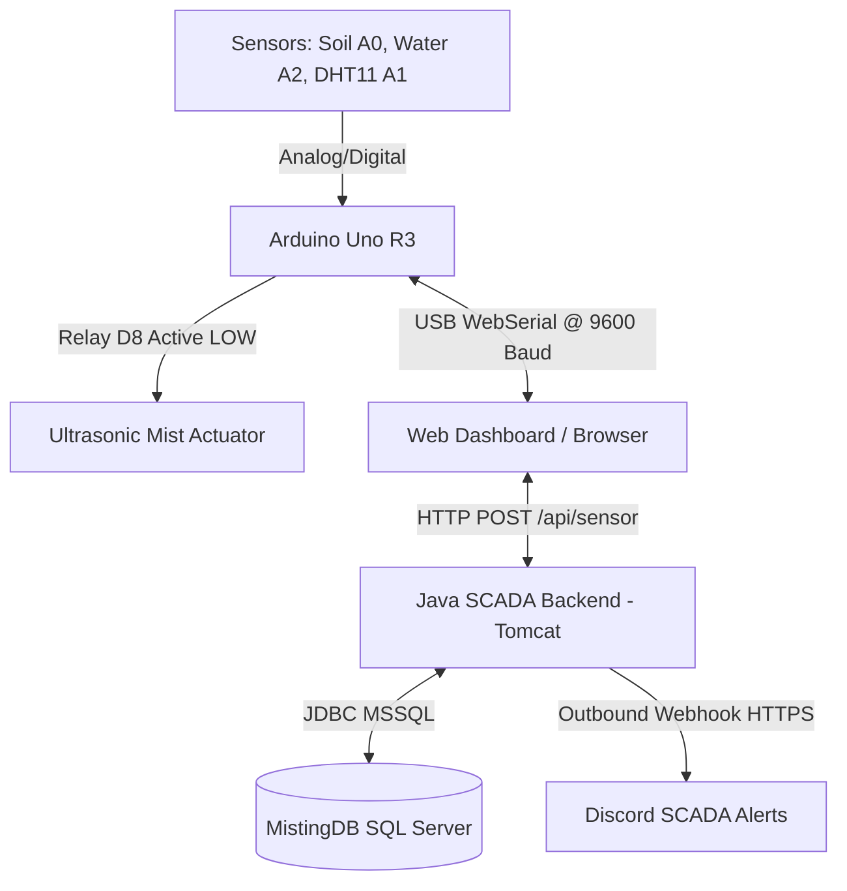

# Smart Misting SCADA & Botanical Microclimate Intelligence System

> **PRJ301 - IoT Agriculture & Automation Project**  
> **Target Plant**: *Ludisia discolor* (Jewel Orchid / Lan Gấm)  
> **Platform**: Java Servlet & JSP (JDK 1.8), Apache Tomcat 9/10, Microsoft SQL Server, Arduino Uno R3, Three.js 3D Digital Twin.

---

## 📌 Project Overview

Smart Misting System is an enterprise-grade IoT SCADA application designed to automate, monitor, and regulate precision microclimates for sensitive botanical specimens (*Ludisia discolor*). The system combines real-time hardware telemetry via WebSerial, interactive 3D digital twin visualization, and outbound operational notifications via Discord webhooks.

---

## 🏗️ System Architecture



---

## 🌟 Key Features

1. **3D Digital Twin Terrarium**:
   - Interactive 3D visualization using Three.js displaying the physical terrarium, specimen canopy, fluid levels, and real-time mist particle dispersion.
   - Sensor spotlight callouts highlighting individual sensor nodes upon inspection.

2. **Real-time Honeycomb Telemetry**:
   - **SOIL**: Substrate moisture percentage ($0 - 100\%$).
   - **TANK**: Water reservoir capacity ($0 - 100\%$).
   - **AIR HUM**: Relative humidity from DHT11 probe.
   - **TEMP**: Ambient chamber temperature in $^{\circ}\text{C}$.
   - **MIST**: Live relay actuation state (`ACTIVE` / `IDLE`).

3. **Agronomic Priority Safety Lockouts**:
   - **Low Water Cutoff ($< 20\%$)**: Disables pump to prevent ultrasonic transducer burnout.
   - **Cold Temperature Cutoff ($< 18.0^{\circ}\text{C}$)**: Inhibits misting to avoid cold-water shock on *Ludisia discolor* leaf and root tissues.
   - **Substrate Saturation Cutoff ($> 65\%$)**: Halts irrigation to prevent root hypoxia and bacterial soft rot (*Pythium* rot).
   - **Sensor Diagnostic Guard**: Automatically locks actuation if DHT11 or analog probes disconnect.

4. **Operating Modes**:
   - **AUTO (Closed-Loop SCADA)**: Automatically mist continuously when $\text{Air RH} < 60\%$, maintains state in buffer ($60\% - 69.9\%$), and stops when $\text{Air RH} \ge 70\%$.
   - **MANUAL**: Operator-triggered misting guarded by the hardware priority safety envelope.

5. **Discord SCADA Webhook Integration**:
   - Dispatches formatted Industrial IoT embeds for system status updates, mode transitions, interlocks, and recoveries.

---

## 📂 Project Structure

```
PRJ301_SmartMisting/
├── arduino/
│   ├── iot_banmoinhat/iot_PHUN_LIEN_TUC_V8_SOIL_FIX/
│   │   └── iot_PHUN_LIEN_TUC_V8_SOIL_FIX.ino   # Arduino firmware
│   └── SmartMisting_PRJ301/
├── database/
│   ├── 01_schema.sql                           # Database tables & constraints
│   ├── 02_sample_data.sql                      # Seed data & plant specifications
│   ├── 03_verification.sql                     # Health checks
│   └── FULL_DATABASE_SETUP.sql                 # Complete one-click database setup
├── hardware/
│   └── Original_Wiring.drawio                  # Pinout wiring schematics
├── report/
│   ├── PRJ301_Smart_Misting_Report.docx        # Project documentation
│   └── PRJ301_Smart_Misting_Report.pdf
├── src/java/
│   ├── controller/                             # Servlets (Dashboard, Sensor, Control, etc.)
│   ├── dao/                                    # Data Access Objects
│   ├── filter/                                 # Security & Authentication filters
│   ├── listener/                               # Application lifecycle listeners
│   ├── model/                                  # POJO entity models
│   ├── service/                                # SCADA core, AlertService, DiscordNotifier
│   └── util/                                   # Database & JSON helpers
├── web/
│   ├── WEB-INF/
│   │   ├── views/                              # Protected JSP views
│   │   └── web.xml                             # Servlet mappings
│   ├── css/                                    # Responsive styling & 3D theme
│   └── js/                                     # main.js, garden3d.js, WebSerial driver
├── build.xml                                   # Apache Ant build script
├── build.bat                                   # Windows quick-build script
└── DEPLOY_TOMCAT.bat                           # Tomcat deployment automation
```

---

## 🚀 Quick Setup & Installation

### 1. Database Setup
1. Open **SQL Server Management Studio (SSMS)**.
2. Run `database/FULL_DATABASE_SETUP.sql` to initialize `MistingDB`, schemas, default accounts, and plant profiles.
3. Configure `prj_sm_config.properties` with your database credentials:
   ```properties
   db.url=jdbc:sqlserver://127.0.0.1:1433;databaseName=MistingDB;encrypt=false;trustServerCertificate=true
   db.user=sa
   db.password=your_password
   discord.webhook.url=your_discord_webhook_url
   ```

### 2. Arduino Hardware Wiring
- **Soil Moisture Sensor**: VCC $\rightarrow$ 5V, GND $\rightarrow$ GND, AO $\rightarrow$ **A0**
- **Water Level Sensor**: VCC $\rightarrow$ 5V, GND $\rightarrow$ GND, SIG $\rightarrow$ **A2**
- **DHT11 Sensor**: VCC $\rightarrow$ 5V, GND $\rightarrow$ GND, DATA $\rightarrow$ **A1**
- **5V Relay Module (Active LOW)**: VCC $\rightarrow$ 5V, GND $\rightarrow$ GND, IN $\rightarrow$ **D8**
- **16x2 LCD**: RS $\rightarrow$ 12, EN $\rightarrow$ 11, D4 $\rightarrow$ 5, D5 $\rightarrow$ 4, D6 $\rightarrow$ 3, D7 $\rightarrow$ 2
- Flash `arduino/iot_banmoinhat/iot_PHUN_LIEN_TUC_V8_SOIL_FIX/iot_PHUN_LIEN_TUC_V8_SOIL_FIX.ino` via Arduino IDE.

### 3. Build & Deploy
1. Build WAR file using Apache Ant:
   ```cmd
   ant dist
   ```
2. Deploy the generated `dist/SmartMistingPRJ.war` to Apache Tomcat's `webapps/` directory.
3. Access the dashboard at `http://localhost:8080/SmartMistingPRJ/`.
4. Plug in Arduino via USB, click **Connect Hardware**, select the serial COM port, and begin live monitoring.

---

## 🔒 Security & Code Standards
- All dynamic JSP views are isolated inside `WEB-INF/views/` to enforce strict MVC controller routing.
- Passwords hashed securely using SHA-256 with salt.
- Built strictly with pure project code and zero external AI telemetry tracking.
